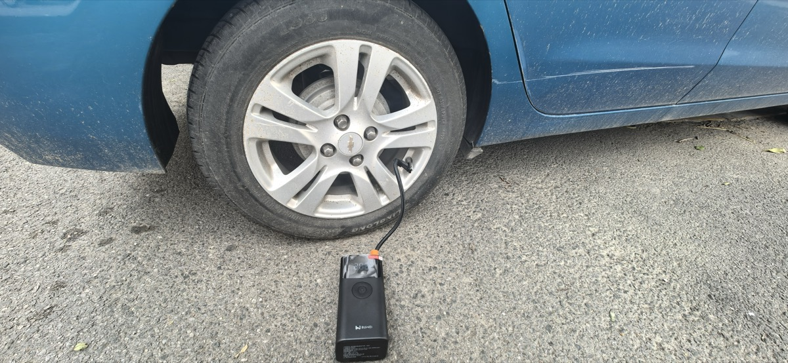

> 本目录(`content/_refer/`)**只在 `preview.sh` 本地可见**,`deploy.sh` 上线时被忽略
> (机制:`QUARTZ_PROD=1` → `ignorePatterns` 加 `_refer/**`)。放示例、草稿、写作参考都行。

## 1. 单图(默认块级)


## 2. 并排两张
<div class="grid2">
  
  
</div>

## 3. 三列
<div class="grid3">
  
  
  
</div>

## 4. 自适应画廊
<div class="gallery">
  
  
  
  
</div>

## 5. 带图注
<figure>
  
  <figcaption>图注:居中、小号灰字。一句话说清这张图在讲什么。</figcaption>
</figure>

## 6. 文字绕图


这是一段正文,图片浮在右侧,文字环绕它排版——这是 md 做不到、只有 float 能做到的「图文咬合」。适合把配图塞进长段落,而不是硬生生地把文字切成两半。注意两个要点:第一,`` 与正文之间**必须空一行**,否则正文会被吸进 HTML 块、不是独立段落,float 就没有东西可绕;第二,绕图适合**横图或方图**,竖长图会把文字挤成一条窄缝。下面再写几句,让文字越过图片底部,回到整行宽度,这个「由窄变宽」的折线,才是绕图的视觉证据。
这是一段正文,图片浮在右侧,文字环绕它排版——这是 md 做不到、只有 float 能做到的「图文咬合」。适合把配图塞进长段落,而不是硬生生地把文字切成两半。注意两个要点:第一,`` 与正文之间**必须空一行**,否则正文会被吸进 HTML 块、不是独立段落,float 就没有东西可绕;第二,绕图适合**横图或方图**,竖长图会把文字挤成一条窄缝。下面再写几句,让文字越过图片底部,回到整行宽度,这个「由窄变宽」的折线,才是绕图的视觉证据。
这是一段正文,图片浮在右侧,文字环绕它排版——这是 md 做不到、只有 float 能做到的「图文咬合」。适合把配图塞进长段落,而不是硬生生地把文字切成两半。注意两个要点:第一,`` 与正文之间**必须空一行**,否则正文会被吸进 HTML 块、不是独立段落,float 就没有东西可绕;第二,绕图适合**横图或方图**,竖长图会把文字挤成一条窄缝。下面再写几句,让文字越过图片底部,回到整行宽度,这个「由窄变宽」的折线,才是绕图的视觉证据。
这是一段正文,图片浮在右侧,文字环绕它排版——这是 md 做不到、只有 float 能做到的「图文咬合」。适合把配图塞进长段落,而不是硬生生地把文字切成两半。注意两个要点:第一,`` 与正文之间**必须空一行**,否则正文会被吸进 HTML 块、不是独立段落,float 就没有东西可绕;第二,绕图适合**横图或方图**,竖长图会把文字挤成一条窄缝。下面再写几句,让文字越过图片底部,回到整行宽度,这个「由窄变宽」的折线,才是绕图的视觉证据。
这是一段正文,图片浮在右侧,文字环绕它排版——这是 md 做不到、只有 float 能做到的「图文咬合」。适合把配图塞进长段落,而不是硬生生地把文字切成两半。注意两个要点:第一,`` 与正文之间**必须空一行**,否则正文会被吸进 HTML 块、不是独立段落,float 就没有东西可绕;第二,绕图适合**横图或方图**,竖长图会把文字挤成一条窄缝。下面再写几句,让文字越过图片底部,回到整行宽度,这个「由窄变宽」的折线,才是绕图的视觉证据。
<div class="clearfix"></div>

## 7. 折叠标题与伸缩文本
### 这节默认折叠{+}
点标题展开才看得到这行。

```telescopic
* 我在深圳
  * 我在深圳骑了29公里
    * 我在深圳环石岩湖骑了29公里,阴天22度,体验很好
```

## 8. 站内链接
参见 [[再见了这里]](如果该页存在)。
