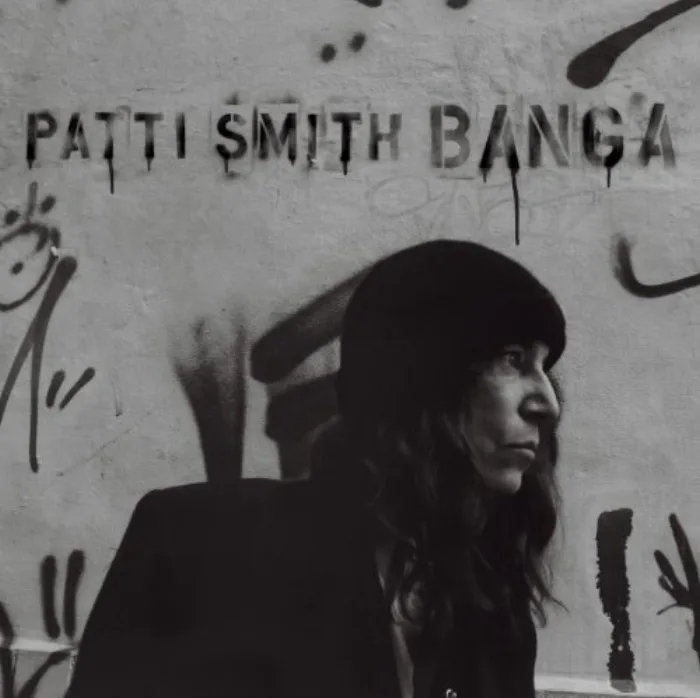

<!-- music:cover:begin -->

<!-- music:cover:end -->

## 版本

<a class="ncm-play" href="https://music.163.com/#/album?id=1672562" target="_blank" rel="noopener" title="在网易云播放整张专辑" aria-label="在网易云播放整张专辑">▶</a>

<a class="ncm-row" href="https://music.163.com/#/song?id=18212255" target="_blank" rel="noopener">1AmerigoPatti Smith · Banga04:36</a>

<!-- music:album:begin -->
## 专辑

Banga is Patti Smith's first collection of original material since 2004's critically-acclaimed Trampin'. The album was recorded at Electric Lady Studios in New York City and produced by Patti Smith and her band: Tony Shanahan, Jay Dee Daugherty and her long-time collaborator Lenny Kaye. Featured guests include Tom Verlaine, Jack Petruzzelli, Smith's son Jackson and daughter Jesse Paris. Inspired by Smith's unique dreams and observations, Banga's poetic lyrics are a reflection of our complex world a world that is rife with chaos and beauty. Praised for her storytelling abilities, Smith has crafted an album that captures a wide range of human experience. There is an exploratory spirit in the songs that make up Banga, including a melodic overture imagining the voyage of Amerigo Vespucci to the New World in 1497 ("Amerigo"), a rock song for the people of Japan in the wake of last years earthquake ("Fuji-san"), a classic ballad in memory of Amy Winehouse ("This Is The Girl"), an improvised meditation on art and nature ("Constantine's Dream") as well as a birthday song written for her friend Johnny Depp ("Nine"). Banga is available on CD, LP, and as a Special Edition hard cover book including 64 pages of original images, complete lyrics & liner notes by the artist plus an exclusive track, "Just Kids."

- 专辑：Banga（2012）
- 艺人：Patti Smith
- 厂牌：Sony Music
- 发行：2012-06-05
- 评分：9.1（NeoDB）
- 资料：[NeoDB](https://neodb.social/album/4awRIl3WcGXfDnihJCMPhu) · [Douban](https://music.douban.com/subject/10574397/) · [网易云音乐](https://music.163.com/#/album?id=1672562)
<!-- music:album:end -->
