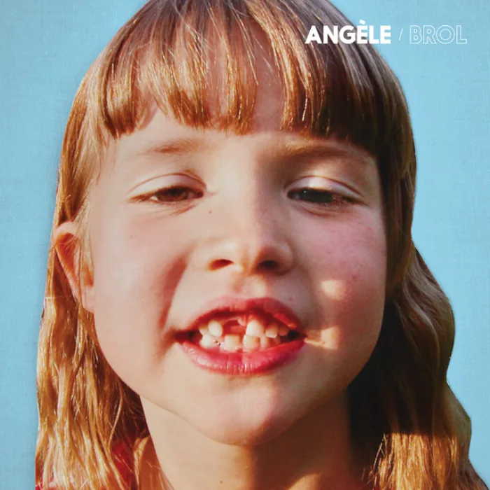

<!-- gencover:cover:begin -->

<!-- gencover:cover:end -->

## 曲目

- [La thune](https://music.163.com/#/song?id=1315753879) — 03:22

▶ 网易云播放器 · Brol

<iframe frameborder="no" border="0" marginwidth="0" marginheight="0" width="100%" height="430" src="https://music.163.com/outchain/player?type=1&id=73796268&auto=0&height=430"></iframe>

<!-- gencover:begin -->
## 专辑简介

Angèle © 2018 Saïmiri ℗ 2018 Saïmiri  Brol

- 艺人：Angèle
- 厂牌：© 2018 Saïmiri、℗ 2018 Saïmiri
- 发行：2018-10-05
- 曲目：181
- 评分：7.3（NeoDB）
- 资料：[NeoDB](https://neodb.social/album/2ZxzfktX0IUGMeVRE0HOsp) · [Douban](https://music.douban.com/subject/34541159/) · [网易云音乐](https://music.163.com/#/album?id=73796268)

<!-- gencover:end -->
