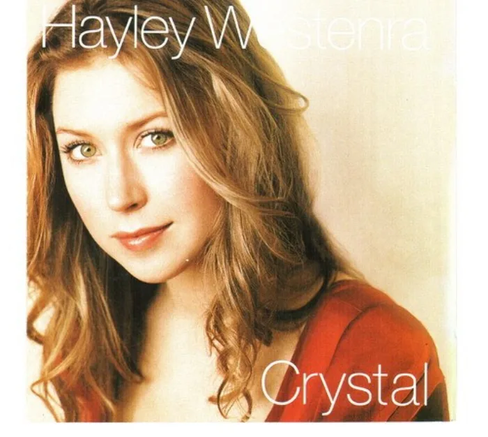

<!-- gencover:cover:begin -->

<!-- gencover:cover:end -->

## 曲目

<a class="ncm-play" href="https://music.163.com/#/album?id=272350" target="_blank" rel="noopener" title="在网易云播放整张专辑" aria-label="在网易云播放整张专辑">▶</a>

<a class="ncm-row" href="https://music.163.com/#/song?id=2700479" target="_blank" rel="noopener">1Scaborough Fair03:11</a>

<!-- gencover:begin -->
## 专辑简介

2006年3月22日在海莉·薇思特拉推出英国特别版的《ODYSSEY》前，日本DECCA公司先推出了她的日本特别版，更名为《Crystal - Classical Favourites》。专辑收入新曲“The Water is Wide”，日剧《白色巨塔》主题“Amazing Grace”，以及古典歌剧热门曲“O Mio Babbino Caro”及“Scaborough Fair”，这两首曲目都曾被多位女高音大腕所演唱过，海莉此次演绎，应该是给自己一个新的起点。

- 艺人：Hayley Westenra
- 厂牌：DECCA
- 发行：2006-03-22
- 资料：[NeoDB](https://neodb.social/album/10zO1IdXVP0FwwssysKtvk) · [Douban](https://music.douban.com/subject/2296431/) · [网易云音乐](https://music.163.com/#/album?id=272350)

<!-- gencover:end -->
