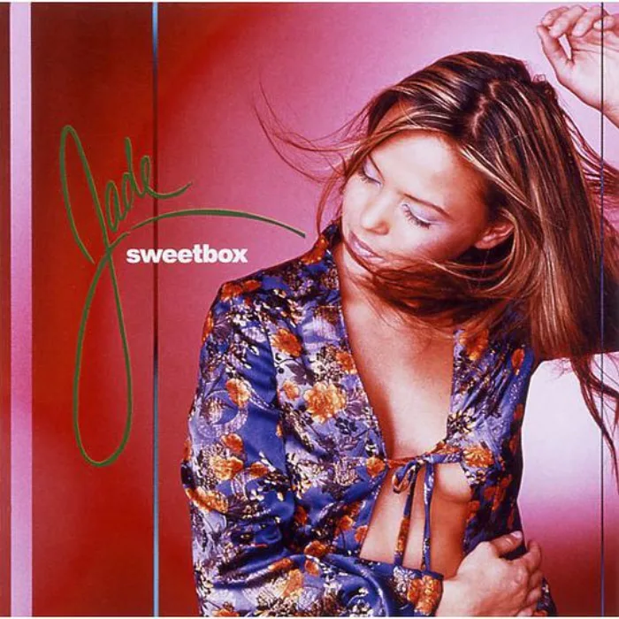

<!-- music:cover:begin -->

<!-- music:cover:end -->

## 版本

<a class="ncm-play" href="https://music.163.com/#/album?id=1886784" target="_blank" rel="noopener" title="在网易云播放整张专辑" aria-label="在网易云播放整张专辑">▶</a>

<a class="ncm-row" href="https://music.163.com/#/song?id=20310407" target="_blank" rel="noopener">1DON'T PUSH MESweetbox · JADE03:15</a>

<!-- music:album:begin -->
## 专辑

德國王牌製作人GEO量身打造．S.H.E.的最愛，發跡德國，走紅歐美，轟動日本的流行組合．日本公信榜排行專輯 S.H.E.「Remember」、「Read My Mind」原曲原唱組合，收錄「Read My Mind」同名原曲、日本電台點播金曲「Unforgiven」，亞洲特別版附贈2首混音新曲+中文詳細介紹與歌詞。

- 专辑：JADE（2002）
- 艺人：Sweetbox
- 厂牌：Avex Trax
- 发行：2002-09-26
- 资料：[NeoDB](https://neodb.social/album/1gys3Ve1wJQshKDtKXtrOL) · [Douban](https://music.douban.com/subject/1785689/) · [网易云音乐](https://music.163.com/#/album?id=1886784)
<!-- music:album:end -->
