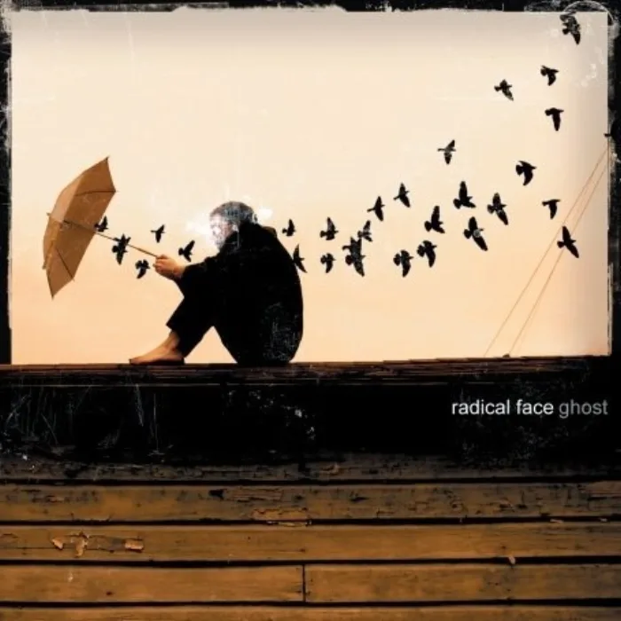

<!-- gencover:cover:begin -->

<!-- gencover:cover:end -->

## 曲目

<a class="ncm-play" href="https://music.163.com/#/album?id=1695884" target="_blank" rel="noopener" title="在网易云播放整张专辑" aria-label="在网易云播放整张专辑">▶</a>

<a class="ncm-row" href="https://music.163.com/#/song?id=18495436" target="_blank" rel="noopener">1Welcome Home04:48</a>

<!-- gencover:begin -->
## 专辑简介

Radical Face来自美国佛罗里达的Jacksonville。本名Ben Cooper，开创新民谣风格的艺人，与Alax Kane组成Electric President并且在04年发行同名专辑《Electric President》。这张11首歌曲的《Ghost》可以说代表了他个人的民谣思想。宁静，不嘈杂，生活的真实。专辑中稍带一些Lo-fi和实验的味道，将人声，童声，风声，生活中的脚步声，开门声，风铃声，自然中的鸟声等等一些生活中的声音以音乐的方式加入歌曲中。一张再真实，淳朴不过的民谣专辑。用钢琴，吉他，伴奏乐器，手风琴及声乐来谱写了11首情感之作。像是一个故事，有开头，有结尾。大量的情感的输出，以悲为主题的一个音乐故事。

- 艺人：Radical Face
- 厂牌：Morr Music、Bear Machine
- 发行：2007-03-02
- 类型：folk
- 曲目：200
- 评分：8.4（NeoDB）
- 资料：[NeoDB](https://neodb.social/album/2DIjzvmWDp6YxnMUzCzOlI) · [Douban](https://music.douban.com/subject/1990406/) · [网易云音乐](https://music.163.com/#/album?id=1695884)

<!-- gencover:end -->
