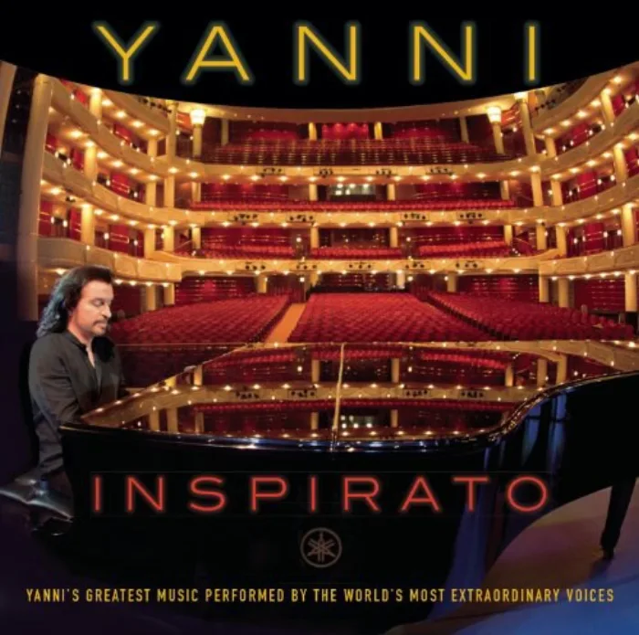

<!-- gencover:cover:begin -->

<!-- gencover:cover:end -->

## 曲目

- Usignolo (Nightingale) — 05:14

<!-- gencover:begin -->
## 专辑简介

Yanni, working in partnership with the legendary operatic superstar Plácido Domingo and producer Ric Wake, has assembled a stellar line-up of the greatest singers to perform on his new album, INSPIRATO. Yanni’s timeless compositions have been transformed by the addition of lyrics and tells the story of the loves of YANNI’s life.
This project took 4 years to complete and over 30 years to compose the music that inspired it. This is a one of a kind album, there has never been another album like this and there will never be another album like this.

- 艺人：Yanni
- 厂牌：Sony Classical
- 发行：2014-04-01
- 类型：pop
- 曲目：728
- 资料：[NeoDB](https://neodb.social/album/3z0ZQu2B66EB5dxWij3nvS) · [Douban](https://music.douban.com/subject/25840022/)

<!-- gencover:end -->
