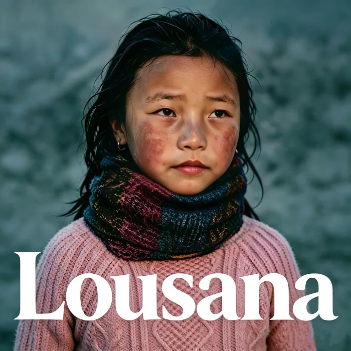

<!-- gencover:cover:begin -->

<!-- gencover:cover:end -->

## 曲目

- [Lousana（离别）](https://music.163.com/#/song?id=3398057570) — 03:47

▶ 网易云播放器 · Lousana

<iframe frameborder="no" border="0" marginwidth="0" marginheight="0" width="100%" height="430" src="https://music.163.com/outchain/player?type=1&id=383628729&auto=0&height=430"></iframe>

<!-- gencover:begin -->
## 专辑信息

- 艺人：史航奇
- 发行：2026-06-26
- 曲目：1
- 资料：[网易云音乐](https://music.163.com/#/album?id=383628729)

<!-- gencover:end -->
