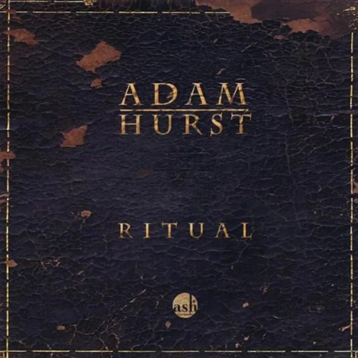

<!-- music:cover:begin -->

<!-- music:cover:end -->

## 版本

<a class="ncm-play" href="https://music.163.com/#/album?id=111632" target="_blank" rel="noopener" title="在网易云播放整张专辑" aria-label="在网易云播放整张专辑">▶</a>

<a class="ncm-row" href="https://music.163.com/#/song?id=1070924" target="_blank" rel="noopener">1Midnight WaltzAdam Hurst · Ritual04:31</a>

<!-- music:album:begin -->
## 专辑

亚当·郝斯特，是一位获奖无数的大提琴家和作曲家，其深受中东、印度和欧洲传统音乐影响，他的独奏浪漫空灵、静怡忧伤，富有诗意并充满激情，旋律厚重能够震撼聆听者的心灵。

- 专辑：Ritual（2009）
- 艺人：Adam Hurst
- 发行：2009-04-07
- 评分：8.5（NeoDB）
- 资料：[NeoDB](https://neodb.social/album/6Y3CYg8O4ShQztrVWtJFud) · [Douban](https://music.douban.com/subject/3903561/) · [网易云音乐](https://music.163.com/#/album?id=111632)
<!-- music:album:end -->
