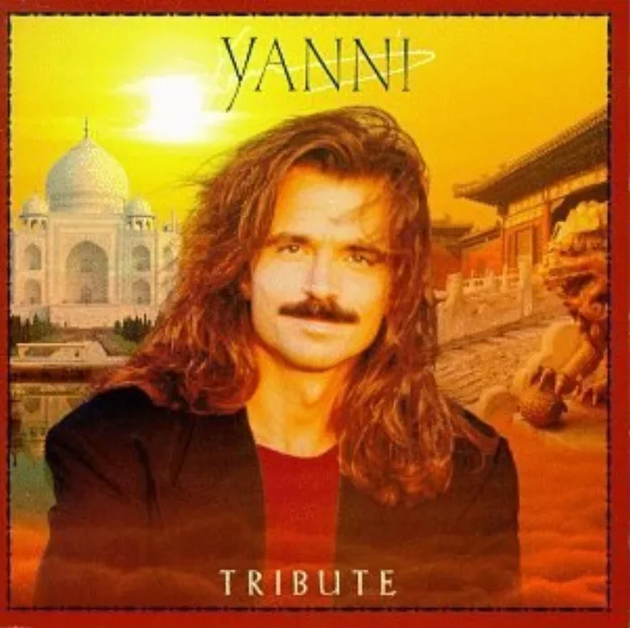

<!-- music:cover:begin -->

<!-- music:cover:end -->

## 版本

<a class="ncm-play" href="https://music.163.com/#/album?id=1926665" target="_blank" rel="noopener" title="在网易云播放整张专辑" aria-label="在网易云播放整张专辑">▶</a>

<a class="ncm-row" href="https://music.163.com/#/song?id=20744782" target="_blank" rel="noopener">1NightingaleYanni · Tribute05:46</a>

<!-- music:album:begin -->
## 专辑

介 这是雅尼1997年在北京紫禁城和印度泰姬陵的音乐会专辑，它包括九首新作和两首旧作的改编版。全专辑充满激情，激荡人心，首首不同凡响。管弦乐队的演奏，歌手的演唱，乐手们的solo交融在一起，雅尼的音乐从未如此丰富多采过，特别是Alfreda Gerald，Vann Johnson的演唱和Pedro Eustache的各种笛子及 saxophone 的演奏,为雅尼的音乐增添了前所未有的亮点。较之卫城音乐会，本专辑音乐中的管弦乐队和乐手们的solo融合得更加自然，旋律也不再像从前那样相对单一，一些地方可称妙手偶得。在中国和印度演出后，不少中国人就开始知道了了解了YANNI的音乐和他的风格。本次音乐在在两地都掀起了观众热情的高潮，在Niki Nana一曲中所有观众和乐队全部成员都站起来随着乐曲尽情舞蹈，显示了对雅尼乐队的喜爱

- 专辑：Tribute（1997）
- 艺人：Yanni
- 厂牌：Virgin
- 发行：1997-01-01
- 评分：8.5（NeoDB）
- 资料：[NeoDB](https://neodb.social/album/4qzs89aZn9TJLre0KOx0XN) · [Douban](https://music.douban.com/subject/1401230/) · [网易云音乐](https://music.163.com/#/album?id=1926665)
<!-- music:album:end -->
