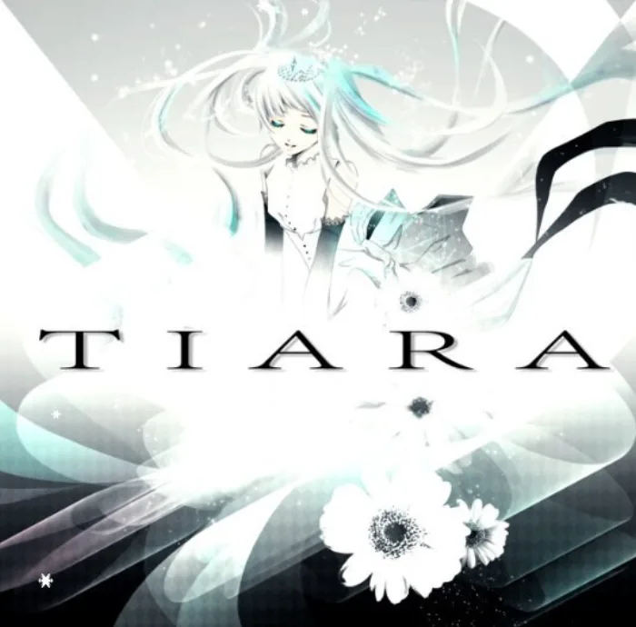

<!-- gencover:cover:begin -->

<!-- gencover:cover:end -->

## 曲目

<a class="ncm-play" href="https://music.163.com/#/album?id=3279670" target="_blank" rel="noopener" title="在网易云播放整张专辑" aria-label="在网易云播放整张专辑">▶</a>

<a class="ncm-row" href="https://music.163.com/#/song?id=34528606" target="_blank" rel="noopener">1Umbrella05:03</a>

<!-- gencover:begin -->
## 专辑简介

新曲『GravityRain』を含め、
現在カラオケ配信されている楽曲をブラッシュアップ。
アウトプット氏とのコラボ楽曲『BALLOON』
至極のミディアムバラード『Umbrella』
切ないエレクトロポップ『SAYONARA』
初音ミクProjectDIVA-Arcade-にて配信中の
『悠久-Song of Eternity-』フルバージョン
初の殿堂入りを達成した『Undefined』
そして、物語を紡ぐ3部作の完結編『Soleil』
全13曲、殿堂入り5曲を収録した
1st.アルバムをiTunesStoreなど限定配信開始。
GravityRain
◆Vocal : 初音ミク
◆Lyrics / Music : てぃあら
◆Arrangement : てぃあら & StudioTiara@Jun
◆Electric Violin : たしふん
◆Illustration / Movies : AO

- 艺人：てぃあら
- 厂牌：StudioTiara
- 发行：2015-08-22
- 曲目：356
- 评分：7.6（NeoDB）
- 资料：[NeoDB](https://neodb.social/album/6sKsQoYLb8W8wVpwiCFOO5) · [Douban](https://music.douban.com/subject/26605427/) · [网易云音乐](https://music.163.com/#/album?id=3279670)

<!-- gencover:end -->
