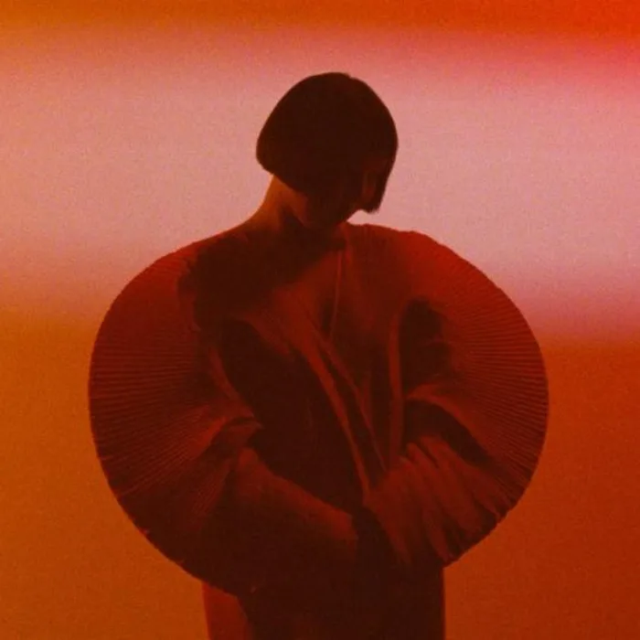

<!-- music:cover:begin -->

<!-- music:cover:end -->

## 版本

<a class="ncm-play" href="https://music.163.com/#/album?id=170273351" target="_blank" rel="noopener" title="在网易云播放整张专辑" aria-label="在网易云播放整张专辑">▶</a>

<a class="ncm-row" href="https://music.163.com/#/song?id=2066723202" target="_blank" rel="noopener">1Temeen Deerees Naran OirhonEnji · Ulaan03:43</a>

<!-- music:album:begin -->
## 专辑

Enji begins her third album with a stark reminder of her own humanity. “I am Ulaan,” she utters plainly in her native language of Mongolian, referring to a nickname affectionately given to her by her family. “I have to remember who I am,” she says, explaining her choice of a spoken monologue. “It empowers me.”
Throughout Ulaan, Enji continues to find new ways to bring out those affirming expressions of herself. Drawing on the elegant blend of jazz and traditional Mongolian song on her previous album Ursgal, she leans into her strengths while breaking into bold new directions. With trusted collaborators Paul Brändle on guitar and Munguntovch Tsolmonbayar on bass at her side once again, she expands the band to include Mariá Portugal on drums and Joana Queiroz on clarinet—and her creative process expands along with it. “They have such deep feelings and such deep love of music,” Enji says of the group. As a result of these new partnerships, the compositions have opened up, bringing in lusher textures, more rhythm, and more interplay between musicians. Enji pushes her voice to new heights, too, effervescently fluttering over each track and moving in perfect lockstep with her band.
Songs bubble up from spontaneous moments of inspiration. With “Zuud,” the imagery came to Enji in a melancholic... dream. On “Uzegdel,” she evokes the feeling of a breathtaking view she saw from the window of an early Autumn flight on her way home to Mongolia. “Vogl” comes from her experience visiting the peaceful village of the same name, tracing the shape of the natural vista with her vocals. In some cases, she described these scenes to the band and worked out the feeling together. In others, the songs crystallized from reading out the lyrics. “I find my mother tongue in Mongolian is such a rhythmical language,” Enji explains. “So the melody just came out.”
As Enji continues her journey of self-discovery, she continues to grow and adapt into new roles. With Ulaan, she bares more of her heart than we’ve seen from her yet, but she’s still got more to give—as a vocalist, a bandleader, and most importantly, as a storyteller.
- shy thompson
Performed by
Enkhjargal Erkhembayar (vocals)
Joana Queiroz (clarinet, bassclarinet)
Paul Brändle (guitar)
Munguntovch Tsolmonbayar (bass)
Mariá Portugal (drums)
Trumpet on *Taivshral* by Matthias Lindermayr
Composed by
Enkhjargal Erkhembayar and Paul Brändle
*Encanto* by Joana Queiroz
*Temeen Deerees Naran Oirhon* by Adarsuren P., Sergelen H., Shagdar J.
Recorded by Jan Krause at Mastermix Studio.
Mixed by Martin Brugger.
Mastered and cut by Andreas *Lupo* Lubich.
Produced by Martin Brugger.
Creative Direction and Design by Maximilian Schachtner.
Video-/Photography by Lara Fritz and Hanne Kaunicnik.
Styling by Laura Fries and Carolin Tušl at FRECK.
Supported by Initiative Musik gGmbH with project funds from the Federal Government Commissioner for Culture and Media.

- 专辑：Ulaan（2023）
- 艺人：Enji
- 厂牌：Squama
- 发行：2023-07-28
- 评分：8.3（NeoDB）
- 资料：[NeoDB](https://neodb.social/album/6zdoOsNBsIfE7r6TL2cvQE) · [Douban](https://music.douban.com/subject/36460597/) · [网易云音乐](https://music.163.com/#/album?id=170273351)
<!-- music:album:end -->
