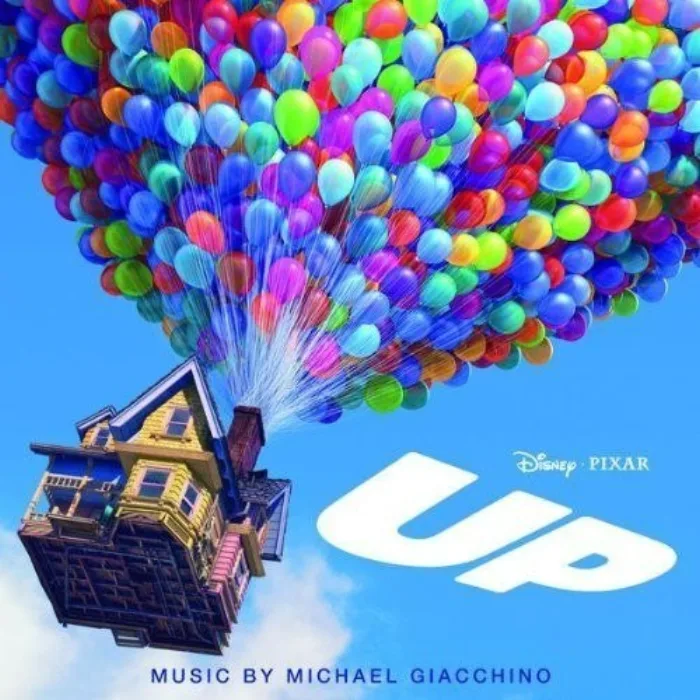

<!-- gencover:cover:begin -->

<!-- gencover:cover:end -->

## 曲目

- [Married Life (电影《飞屋环游记》配乐)](https://music.163.com/#/song?id=1709302) — 04:11

▶ 网易云播放器 · Up

<iframe frameborder="no" border="0" marginwidth="0" marginheight="0" width="100%" height="430" src="https://music.163.com/outchain/player?type=1&id=173193&auto=0&height=430"></iframe>

<!-- gencover:begin -->
## 专辑简介

GRAMMY® Award winning composer Michael Giacchino score to a comedy adventure about 78 year-old balloon salesman Carl Fredricksen, who finally fulfills his lifelong dream of a great adventure when he ties thousands of balloons to his house and flies away to the wilds of South America.
Giacchino composed period music, waltzes, and visually evocative sounds for the Up Soundtrack, his third score for Disney Pixar, after The Incredibles (with its James Bond, spy film musical vibe) and Ratatouille (evoking the wistful, smoky sounds of Parisian streets).
He provided the music for the recently-released Star Trek and Land of the Lost films, as well as the television soundtracks for Alias, Lost, and Fringe. Other works include the soundtracks for Mission: Impossible III, Speed Racer, The Family Stone, and numerous video games.
Disney Pixar's Up Soundtrack flies high behind the first-class compositions of Michael Giaccino. The music will be especially memorable to those who have seen the film, but even if you haven't been to the theater to watch the movie yet, the Up Soundtrack is a treat to the ears.
The Up Soundtrack is only available as a digital download.

- 艺人：Michael Giacchino
- 厂牌：Walt Disney Records
- 发行：2009-05-26
- 类型：soundtrack
- 曲目：850
- 评分：8.8（NeoDB）
- 资料：[NeoDB](https://neodb.social/album/6pGIFprNe9GXny9WAaqe34) · [Douban](https://music.douban.com/subject/3765324/) · [网易云音乐](https://music.163.com/#/album?id=173193)

<!-- gencover:end -->
