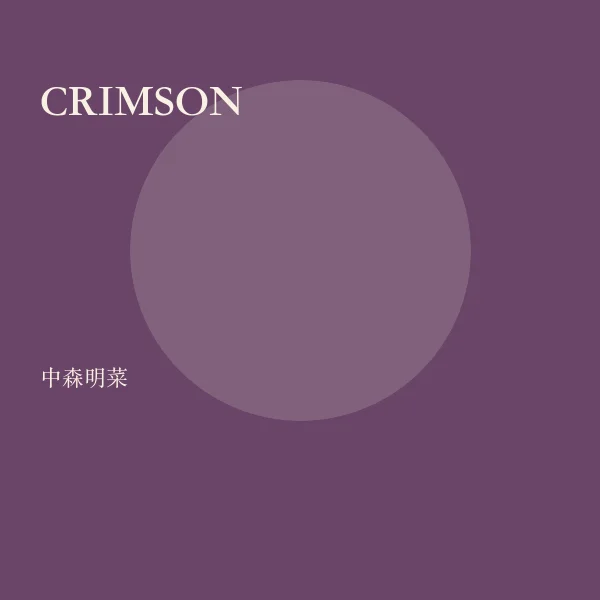

<!-- music:cover:begin -->

<!-- music:cover:end -->

## 版本

<a class="ncm-play" href="https://music.163.com/#/album?id=2078406" target="_blank" rel="noopener" title="在网易云播放整张专辑" aria-label="在网易云播放整张专辑">▶</a>

<a class="ncm-row" href="https://music.163.com/#/song?id=22663885" target="_blank" rel="noopener">1ミック・ジャガーに微笑みを中森明菜 · CRIMSON04:41</a>

<!-- music:album:begin -->
## 专辑

- 专辑：CRIMSON
- 艺人：中森明菜
- 资料：[网易云音乐](https://music.163.com/#/album?id=2078406)
<!-- music:album:end -->
