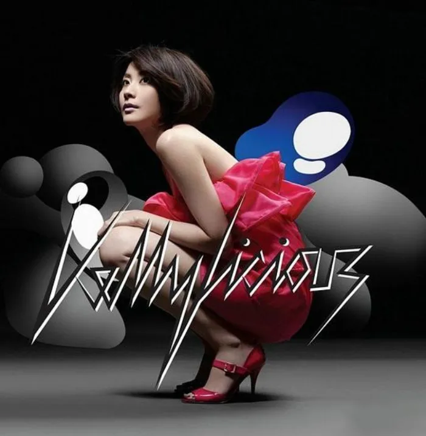

<!-- music:cover:begin -->

<!-- music:cover:end -->

## 版本

<a class="ncm-play" href="https://music.163.com/#/album?id=21615" target="_blank" rel="noopener" title="在网易云播放整张专辑" aria-label="在网易云播放整张专辑">▶</a>

<a class="ncm-row" href="https://music.163.com/#/song?id=213292" target="_blank" rel="noopener">1有时寂寞陈慧琳 · Kellylicious03:59</a>

<!-- music:album:begin -->
## 专辑

2008年，陳慧琳全面回歸，繼年初上演了她與黎明合拍程小東的古裝浪漫大作《江山美人》之後，闊別了紅館四年的Kelly將於6月舉行第五次個人演唱會《陳慧琳Love Fighters演唱會08》，並推出年度全新廣東大碟《Kellylicious》。率先曝光新作「抱歉 柯德利夏萍」為一首中板的情歌，由黃偉文譜詞，舒文的編曲傷感中卻帶節奏時代感。接力主打歌「有時寂寞」則由好拍檔雷頌德一手包辦作曲、編曲及監製，詞中談及寂寞的樂趣，Kelly一改以往情歌的曲式，以懶洋洋的心情來演繹。
碟內還收錄了Kelly在2007年中秋節主打的廣告歌「最好給最好」，以及她與黎明為電影《江山美人》合唱的國語主題曲「隨夢而飛」等11首新作。隨碟附上的DVD特別加送四首新歌MV。

- 专辑：Kellylicious（2008）
- 艺人：陈慧琳
- 厂牌：正東唱片 (HK)
- 发行：2008-05-16
- 评分：6.8（NeoDB）
- 资料：[NeoDB](https://neodb.social/album/5WAC8CY4KiJlezNRVXtP3b) · [Douban](https://music.douban.com/subject/3068862/) · [网易云音乐](https://music.163.com/#/album?id=21615)
<!-- music:album:end -->
