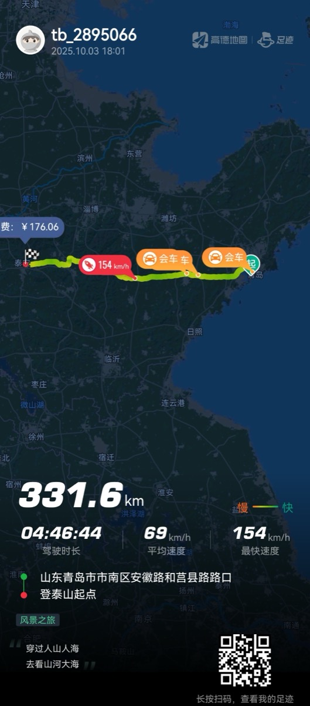
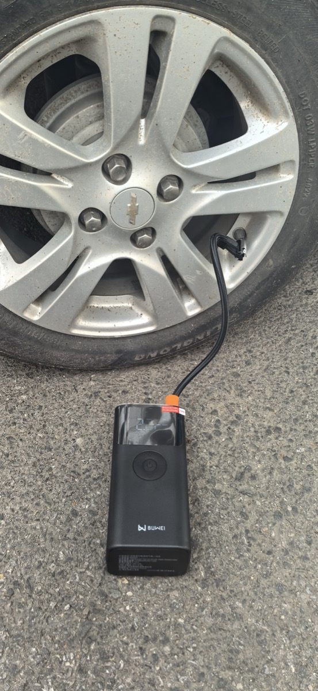

> mock · 演示「图文 + 视频混排,图片跟着 md 走」

[[深圳骑行]] 里体验最好的一条。湿地公园里围着湖骑,没有坡、风景好、难度小。

出发前在 P2 停车场出口租了辆车,10 块一小时、30 封顶,押金只要 50——在深圳算相当便宜。

真要环湖,大概有 1/5 路段在马路边,其余都在公园里。全程 29 公里,路不熟,一开始在湿地公园绕了好几圈。

下面这段是骑到湖心栈道那会儿随手拍的:

两张随手:

骑行是身体的事,不是道理的事——正好呼应 [[认知无法通过学习提升]]:行动之后的感触,才叫认知。

相关:[[大沙河骑到深圳湾]] · [[深圳骑行]]
